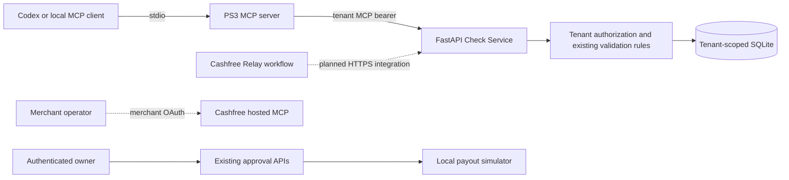

# PS3 MCP architecture

## Responsibilities and boundaries

- **Project MCP** launches as a local subprocess using the official Python MCP
  SDK. It calls a fixed set of authenticated Check Service routes using one
  configured tenant credential. Tool arguments cannot set the tenant, URL or
  credential.
- **Check Service** verifies the bearer and resolves its tenant. The dedicated
  `mcp` role can read invoice details, priorities and simulated payment status
  and submit a non-persisting preview. The role cannot issue or confirm approvals,
  write invoices, revalidate saved invoices, run Sarvam agents, or initiate payouts.
- **Cashfree hosted MCP** at `https://mcp.cashfree.com/mcp` is a separate
  Cashfree-managed service. Merchant OAuth registration previously returned HTTP
  403 before consent. Its workspace and live tool schemas are unverified.
- **Cashfree Payouts** uses separate provider APIs and credentials. The repository
  uses the simulator, and the project MCP exposes only its recorded payment status.

## MCP tools and schemas

The client can fetch the full JSON Schemas with `tools/list`. The input models
are in `app/schemas/invoice.py`, the output models in `app/schemas/mcp.py` and the
bindings in `app/mcp_server/server.py`.

| Tool | Arguments | Structured result |
| --- | --- | --- |
| `get_invoice` | `invoice_id`, positive integer | Invoice ID, overall status, check codes and field names, risk indicators, deadline, priority score and approval eligibility |
| `get_validation_reasons` | `invoice_id`, positive integer | Overall status, check codes with statuses and field names, and risk indicators |
| `get_invoice_priorities` | Optional `limit`, integer 1–100, default 20 | `invoices` array in backend priority order, with the same projection as `get_invoice` |
| `get_payment_status` | `payment_id`, positive integer | Internal payment and invoice IDs, status, decimal amount and currency |
| `validate_invoice` | `invoice` object following `InvoicePreviewInput` | `preview: true`, overall status, check codes with statuses and field names, and risk indicators |

The preview accepts the invoice number, date, supplier GSTIN and legal name,
currency, quantities and unit prices, totals and taxes, optional amount in words,
and field confidence. Use decimal strings for amounts and ISO dates. Verified
banking details, document hashes, acceptance dates and agreement flags are
outside the preview schema. The existing evaluator executes in a rolled-back
savepoint, including invoice, validation and audit writes. A preview does not
create an invoice ID or approval eligibility. Missing trusted facts hold an
otherwise valid preview, and blocking errors still take precedence.

The MCP results exclude bank fields, raw evidence, provider transfer references,
approval credentials and free-text diagnostics. Tool errors do not echo rejected
arguments or upstream response bodies. All discovered tools advertise read-only
behavior. A future write tool would require a separate authorization design and
must use the existing authenticated service flow.

## Local setup and request flow

1. Install `requirements.txt`, then run `alembic upgrade head` and seed a
   synthetic database. Start FastAPI as described in the [project README](../../README.md).
2. Generate a separate high-entropy credential and add it to the API process’s
   existing `CHECK_BEARER_KEYS` JSON map with `{"business_id":1,"role":"mcp"}`.
   Keep existing entries and use one dedicated credential per tenant.
3. Set `CHECK_MCP_SERVICE_TOKEN` in the environment of the client process to
   that credential. Set `CHECK_MCP_BASE_URL` to the API origin, or use its
   default `http://127.0.0.1:8000`.
4. Configure a local stdio client to launch `python -m app.mcp_server.server`
   from the repository root. For Codex, see the [example configuration](../../mcp/codex-config.example.toml).
5. Startup checks `GET /api/v1/mcp/access` before serving MCP. The client then
   initializes, discovers tools, and calls a named tool. The API rechecks
   the credential and tenant on every request before the MCP server projects
   the response into its documented schema.

Inject credentials through the environment or a secret manager. Use HTTPS
outside loopback and keep TLS certificate verification enabled. The HTTP client
disables redirects and environment-injected proxy settings. Keep the API origin
and process environment under operator control and avoid logging request headers
or bodies. Restart the processes after changing their credentials.

## Relay and deployment limitations

Hosted Relay cannot connect directly to this stdio process. A future remote MCP
deployment would require a separately authenticated Streamable HTTP entry point
that enforces per-client tenant scope. An independent Relay integration can
instead call the existing Check Service HTTP endpoints after confirming HTTPS
reachability, secret-backed Bearer headers and test workspace isolation. Use a
role appropriate to the endpoint. Owner approval stays in its separate channel.

No Relay workspace connection, Streamable HTTP listener, or Cashfree payout
adapter is provided by this package. Vendor search is available to the existing
local Sarvam agent and is outside the MCP tool catalog.
